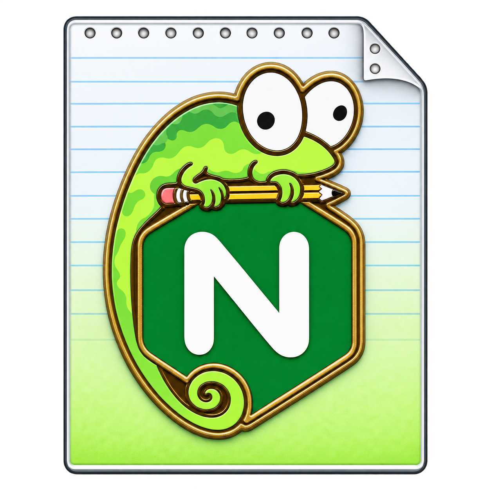

# Nginx syntax highlighting for Notepad++

<p align="center">
  
</p>

User-defined languages (UDLs) for editing Nginx configuration files in Notepad++. The light and dark versions share their keywords and parsing rules, with separate colors.

## Install

1. Download the XML for your editor background:
   - [userDefineLang_nginx.xml](https://raw.githubusercontent.com/dslatten/nginx_npp/master/userDefineLang_nginx.xml): light colors, named `Nginx`.
   - [userDefineLang_nginx_dark.xml](https://raw.githubusercontent.com/dslatten/nginx_npp/master/userDefineLang_nginx_dark.xml): dark colors, named `Nginx-Dark`.
2. In Notepad++, open **Language > User Defined Language > Define your language...**.
3. Click **Import...** and select the downloaded XML file.
4. Close the dialog and restart Notepad++.
5. Open your configuration file and select **Language > Nginx** or **Language > Nginx-Dark**.

Both definitions associate with `.conf` files. If another language also uses that extension, or you import both versions, select the intended language manually. Select `Nginx-Dark` when using a dark editor background; changing Notepad++'s theme does not select a different UDL for you. Files without a `.conf` extension can also use either language through the Language menu.

### Update an existing installation

Download the new XML first. In the UDL dialog, select the existing `Nginx` or `Nginx-Dark` definition. Use **Export...** if you want to keep custom colors or keywords, then **Remove** that definition before importing its replacement. Repeat for the other version if installed, and restart Notepad++.

If you installed XML files directly in Notepad++'s `userDefineLangs` directory, close Notepad++ and replace those files instead. Use one installation method for each language name to avoid duplicate definitions. The [Notepad++ UDL manual](https://npp-user-manual.org/docs/user-defined-language-system/) explains the configuration-file locations.

## Coverage

Both themes recognize **1,155 distinct directive names**.

- **NGINX Open Source 1.31.10.** Command names from the release source include optional and platform-specific modules, HTTP/2, HTTP/3, stream, gRPC, JSON, and CONNECT tunneling.
- **The [official NGINX directive index](https://nginx.org/en/docs/dirindex.html).** The November 23, 2026 snapshot includes documented NGINX Plus, njs, OpenTelemetry, and ACME directives such as `auth_jwt`, `js_import`, `otel_trace`, and `acme_certificate`.
- **[OpenResty 1.31.8.1](https://openresty.org/en/download.html).** Both themes include configuration directives from modules shipped in the release bundle, including Lua, Headers More, and optional modules. A directive such as `content_by_lua_block` receives directive coloring. The editor continues to use Nginx highlighting inside the block.
- **Older configurations.** Both themes retain the original project's keywords, historical directives such as SPDY, and all directive names contributed in the 2024 light and dark pull requests.

Notepad++ colors recognized names even when they appear as unquoted arguments. A highlighted name can belong to a module your server does not load. Independently distributed modules can define additional directives beyond these sources.

The UDL handles comments, quoted strings, variables, named locations, and brace folding. Quoted strings use one consistent style, including any variables inside them. Outside strings, `$name` receives variable styling and `${name}` is protected from brace folding.

UDL highlighting does not validate directive contexts. A `#` embedded in an unquoted argument, such as a URL fragment, can look like a comment; quote that argument for reliable highlighting. Variable styling can also extend across adjacent path text in the same token. See the [visual fixture and review notes](examples/README.md) for cases to check in Notepad++.

## Maintain the definitions

The generated XML files are committed so users can install them without Python. To change the definitions, use **Python 3.9 or newer**. The tools use only the Python standard library.

- [`src/keywords.json`](src/keywords.json) contains the core and historical vocabulary, parameter names, and prefixes.
- [`src/module-catalogs/`](src/module-catalogs) contains the official index, OpenResty, and community keyword lists. Each file records its source. The generator combines the lists and removes duplicates for both themes.
- [`src/lexer.json`](src/lexer.json) contains the shared parsing and folding rules.
- [`src/themes.json`](src/themes.json) contains the light and dark styles.
- [`src/sources.json`](src/sources.json) records vocabulary provenance and the source version.

The `src/Words*.txt` files are generated, readable keyword references.

Run these commands from the repository root after editing the source files:

```sh
python tools/generate.py
python tools/generate.py --check
python -m unittest discover -s tests -v
```

`--check` verifies that the committed output matches the generator without rewriting it. Make vocabulary and style changes in `src`, then regenerate both XML files together.

To refresh keywords for a new Nginx release, download and extract its source archive from the [official downloads page](https://nginx.org/en/download.html). Point the updater at the extracted source directory and supply that release's version:

```sh
python tools/update_keywords.py --source-dir PATH --version VERSION
python tools/generate.py
python tools/generate.py --check
```

Replace `PATH` with the extracted Nginx source directory, quoting it if it contains spaces, and replace `VERSION` with its version number. Review the changes to the vocabulary, provenance, and generated files before committing. The updater reads source files; it does not build or run Nginx.

To add coverage from another historical release, append `--legacy-source OLD_VERSION OLD_PATH` to the updater command. The option can be repeated. Historical sources enrich the compatibility list without replacing the current release's vocabulary. Provenance is recorded in `src/sources.json`.

To refresh the other upstream sources, save the [NGINX directive index](https://nginx.org/en/docs/dirindex.html) as HTML and download an [OpenResty source archive](https://openresty.org/en/download.html). Run the commands below with the saved paths, the date you retrieved the index, and the matching OpenResty version. Both extractors run offline. Names that disappear from a later snapshot remain available for older configurations.

```sh
python tools/extract_directive_index.py --input PATH_TO_HTML --retrieved YYYY-MM-DD
python tools/extract_openresty.py --archive PATH_TO_TAR_GZ --version OPENRESTY_VERSION
python tools/generate.py
python tools/generate.py --check
python -m unittest discover -s tests -v
```

### Validate a change

Run the generation check and unit tests, then import both generated XML files into a current Notepad++ installation. Open [`examples/highlighting.conf`](examples/highlighting.conf) and [`examples/lexical-edge-cases.conf`](examples/lexical-edge-cases.conf), and follow the [visual review checklist](examples/README.md). Record the Notepad++ version and results when submitting a change. These fixtures are for highlighting review and are not intended to pass `nginx -t`.

On November 22, 2026, both themes were loaded and visually checked in **Notepad++ 8.9.9.1 on Windows** using isolated settings directories. Checks covered modern directives, case sensitivity, empty strings, escaped quotes and backslashes, quoted comment markers, `$name` and `${name}`, named and predicate locations, and block folding. The light check used LF line endings; the dark check used a CRLF copy without a final newline. The GitHub Actions workflow checks generated files and runs the unit tests.

On November 23, 2026, an automated check loaded each expanded theme in the same editor version and verified the assigned color at both ends of every directive name. All 1,155 passed in both themes, along with controls for unknown and uppercase words, variables, named locations, strings, and comments.

## AI assistance

The November 2026 refresh was developed with AI assistance from OpenAI Codex using GPT-6 Astra. The changes were checked with automated tests and visual checks in Notepad++ 8.9.9.1, as described above.

## Contributions

Darren Slatten created the original Nginx language definition for Notepad++.

- Dumitru Uzun (`duzun`) contributed the dark theme and added highlighting for quoted strings. [PR #2](https://github.com/dslatten/nginx_npp/pull/2) and [PR #3](https://github.com/dslatten/nginx_npp/pull/3)
- Alyaxey Yaskevich (`yaskevich`) corrected the Notepad++ menu path in the installation instructions. [PR #4](https://github.com/dslatten/nginx_npp/pull/4)
- `jazini110` contributed the 2024 directive lists now included in both themes. [PR #6](https://github.com/dslatten/nginx_npp/pull/6) and [PR #7](https://github.com/dslatten/nginx_npp/pull/7)
- Sam Saint-Pettersen (`stpettersens`) contributed the `http2` keyword. [PR #8](https://github.com/dslatten/nginx_npp/pull/8)
- `mxxcon` reported that the highlighting colors were hard to read with the Zenburn theme. [Issue #1](https://github.com/dslatten/nginx_npp/issues/1)
- Yaroslav Nakonechnikov (`mrPsycho`) reported unexpected code folding and included a screenshot. [Issue #5](https://github.com/dslatten/nginx_npp/issues/5)

For directive behavior and supported contexts, consult the [Nginx documentation](https://nginx.org/en/docs/). For UDL customization, use the [Notepad++ UDL manual](https://npp-user-manual.org/docs/user-defined-language-system/).
